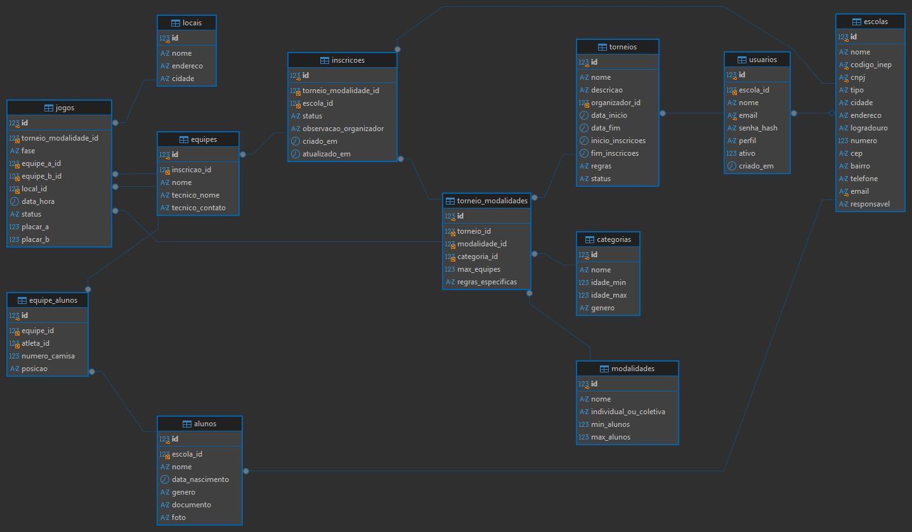

# Sistema de Gestão de Competições Escolares - Modelagem de Banco de Dados


Projeto prático de modelagem relacional de banco de dados para um sistema web centralizado de competições escolares (Vespasiano). O objetivo é substituir o controle manual em planilhas e formulários avulsos por um fluxo integrado de cadastros, inscrições, validações, chaveamento e placares.

---

## Diagrama Entidade-Relacionamento (DER)

O diagrama abaixo foi modelado e validado no **DBeaver**, cobrindo o ciclo de vida completo dos torneios:



---

## Entidades Principais

| Tabela | Descrição |
| :--- | :--- |
| `escolas` | Instituições de ensino participantes com dados cadastrais e contato. |
| `usuarios` | Acessos ao sistema por perfil (`Visitante`, `Escola`, `Organizador`, `Administrador`). |
| `torneios` | Competições criadas por organizadores com datas de abertura, encerramento e regras. |
| `modalidades` | Esportes ou provas (ex: futsal, vôlei, xadrez), tipo (coletivo/individual) e limites de alunos. |
| `categorias` | Faixas etárias e divisões (ex: Sub-15, Sub-17) e gênero. |
| `torneio_modalidades` | Entidade associativa que define quais categorias/modalidades um torneio ofertará. |
| `inscricoes` | Pedidos formais de participação de uma escola em uma modalidade/categoria. |
| `equipes` | Times montados pela escola aprovada, com dados do técnico. |
| `alunos` | Estudantes vinculados unicamente à sua escola. |
| `equipe_alunos` | Relacionamento N:N entre equipes e alunos, com camisa e posição. |
| `locais` | Quadras, ginásios e campos onde ocorrem as partidas. |
| `jogos` | Confrontos com fases, placares, horários e locais definidos. |

---

## Regras de Negócio Refletidas no Modelo

- **RN01 & RN07:** Controle rigoroso de status do torneio (`rascunho`, `inscricoes abertas`, `em andamento`, `encerrado`).
- **RN02:** Inscrições com fluxo de aprovação (`pendente`, `aprovada`, `correcao solicitada`, `recusada`).
- **RN06 & RN09:** Isolamento por escola: usuários institucionais e alunos pertencem obrigatoriamente a uma escola. Organizadores e administradores possuem vínculo global (`NULL`).
- **RN08:** Partidas com controle de status (`agendado`, `em andamento`, `finalizado`), com placar consolidado ao encerramento.
- **Integridade & Unicidade:** Restrições `UNIQUE` compostas que impedem duplicação de categoria no mesmo torneio e duplicidade de aluno na mesma equipe.

---

## Como Executar o Script Localmente

### Pré-requisitos
- MySQL Server 8.0+ instalado ou container Docker
- DBeaver ou MySQL Workbench

### Execução via DBeaver
1. Clone este repositório:
   ```bash
   git clone https://github.com/SEU_USUARIO/NOME_DO_REPOSITORIO.git
   ```
2. Abra o **DBeaver** e conecte-se ao seu servidor MySQL local.
3. Vá em **Arquivo > Abrir Arquivo...** e selecione `sql/schema.sql`.
4. Execute o script com `Alt + X` (Executar Script SQL).
5. O banco `competicao_escolar` e todas as 12 tabelas serão criados automaticamente.

---
Desenvolvido para fins de estudo e prática em modelagem relacional SQL.